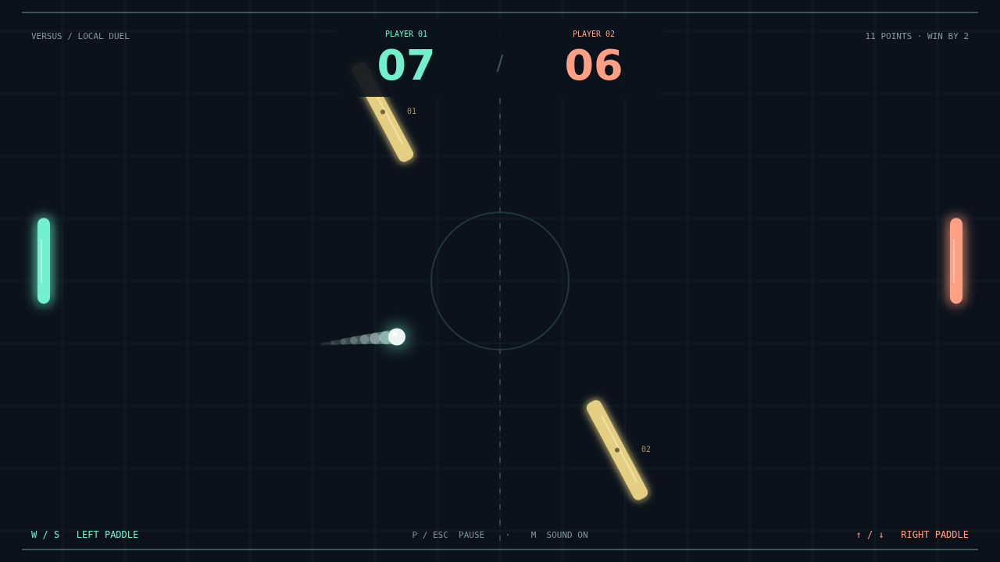

# Carom

Two paddles. One ball. No straight answers. Carom is a quick, top-down duel where
a well-timed touch can turn a safe return into a beautifully awkward shot. Take on
the computer in Solo, or settle a friendly rivalry in local Versus.

Each rally starts with a moment to find your position, then the ball is away.
Meet it squarely to send it across the court, or catch it at the edge of your
paddle to open a sharper angle. Returns get faster, so every exchange asks you
to think a little further ahead.

Move as you strike and the ball bends after contact. Lift it with an upward
stroke or curl it down with a downward sweep. The two gold obstacles never stop
swaying and turning: bank a shot from a tilted face and watch an entirely new
route appear through the middle of the court.

At match point, a small change of angle can be everything. First to eleven wins,
but you need a two-point lead—so a close duel can keep swinging until someone
finds the shot their opponent can't reach.

